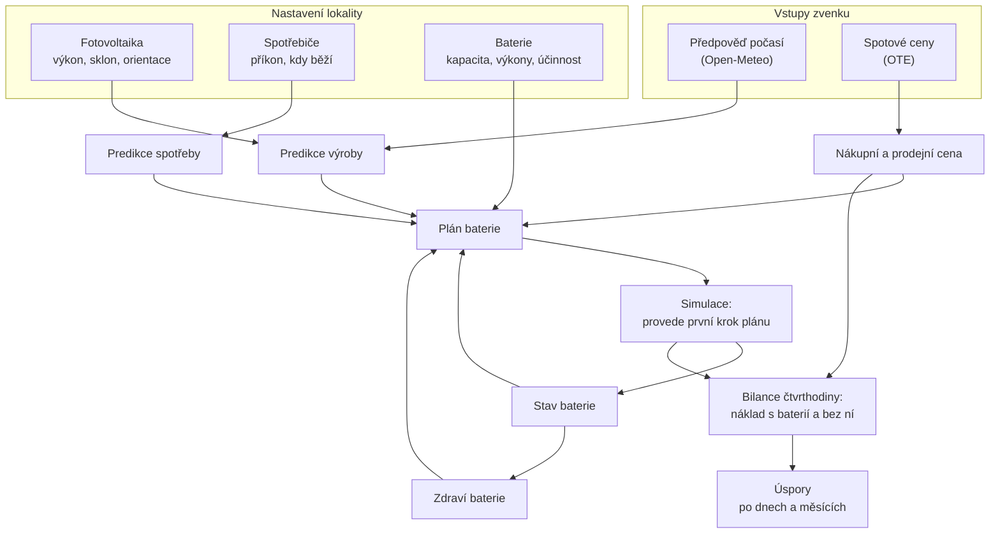

# Přehled systému

EMS (Energy Management System) je aplikace pro domácnost s fotovoltaikou a
baterií. Odpovídá na jednu otázku: **kdy má baterie nabíjet a kdy vybíjet, aby
domácnost zaplatila za elektřinu co nejméně.**

Tento dokument je mapa. Ukazuje, z jakých částí se systém skládá a jak jimi
tečou data. Jednotlivé výpočty jsou podrobně popsané ve složce `vypocty/` a
odkazuje se na ně níže.

Pojmy, které se v dokumentaci opakují, jsou vysvětlené ve
[slovníčku](slovnicek.md).

## Co systém dělá

1. **Zjistí, co ho čeká.** Stáhne předpověď počasí a ceny elektřiny na dnešek a
   zítřek. Z počasí spočítá, kolik vyrobí fotovoltaika. Ze seznamu spotřebičů
   odhadne, kolik domácnost spotřebuje.
2. **Naplánuje baterii.** Pro každou čtvrthodinu rozhodne, jestli má baterie
   nabíjet, vybíjet, nebo stát.
3. **Plán provede a vyúčtuje.** Každou čtvrthodinu vezme první krok plánu,
   zapíše nový stav baterie a spočítá, kolik ta čtvrthodina stála s baterií a
   kolik by stála bez ní.
4. **Ukáže výsledek.** Na dashboardu jsou ceny, predikce, plán, stav baterie a
   úspory.

Systém zatím **neřídí skutečný střídač a nečte skutečná měření**. Baterii
simuluje a výrobu i spotřebu bere z vlastních predikcí. Co to znamená pro
výsledky, je popsané na konci.

## Tři pojmy, bez kterých to nejde

**Výkon a energie.** Výkon (kW) říká, jak rychle elektřina teče právě teď.
Energie (kWh) říká, kolik jí proteklo za nějakou dobu. Platí se za energii.

$$
\text{energie [kWh]} = \text{výkon [kW]} \times \text{čas [h]}
$$

Rychlovarná konvice má výkon 2 kW. Když běží 3 minuty (0,05 h), spotřebuje
2 × 0,05 = 0,1 kWh.

**Krok.** Systém počítá po čtvrthodinách, protože po čtvrthodinách se na trhu
obchoduje elektřina. Všechny řady (ceny, výroba, spotřeba, plán) mají jednu
hodnotu na čtvrthodinu. Čtvrthodina je 0,25 h, takže výkon 2 kW po celou
čtvrthodinu znamená 2 × 0,25 = 0,5 kWh.

**Přebytek a nedostatek.** V každé čtvrthodině se porovná výroba se spotřebou:

- výroba je větší než spotřeba → **přebytek**: jde do baterie, nebo se prodá
  do sítě,
- spotřeba je větší než výroba → **nedostatek**: pokryje ho baterie, nebo se
  dokoupí ze sítě.

Elektřina ze sítě je výrazně dražší, než kolik dostaneš za elektřinu, kterou do
sítě prodáš. Při nákupu totiž platíš i distribuci, marži dodavatele a DPH. Na
tomhle rozdílu baterie vydělává: přebytek, který bys levně prodal, si schová na
dobu, kdy bys draze kupoval.

## Jak systémem tečou data

Šipka `Stav baterie → Plán → Simulace → Stav baterie` tvoří smyčku. Plán vždy
vychází z toho, kde baterie právě je, a provede se z něj jen první krok. Další
čtvrthodinu se naplánuje znovu, už s novým stavem a čerstvějšími predikcemi.

## Co se kdy počítá

Výpočty běží samy na pozadí podle rozvrhu:

| Kdy                  | Co                           | Výsledek                                |
| -------------------- | ---------------------------- | --------------------------------------- |
| každých 30 minut     | stažení spotových cen        | ceny na dnešek a zítřek                 |
| každou hodinu, v :00 | stažení předpovědi počasí    | počasí na 2 dny po čtvrthodinách        |
| každou hodinu, v :10 | predikce výroby fotovoltaiky | výkon každého pole po čtvrthodinách     |
| každou hodinu, v :15 | predikce spotřeby            | spotřeba lokality na 48 hodin           |
| každých 15 minut     | simulace baterie             | nový stav baterie a bilance čtvrthodiny |

Plán baterie se neukládá. Počítá se pokaždé znovu: když ho potřebuje simulace
a když si někdo otevře dashboard.

Ceny se stahují častěji, než se mění. Zítřejší ceny vyjdou jednou denně
odpoledne a pak už se nemění. Časté stahování je pojistka: zdroj nabízí jen
dnešek a zítřek, takže zmeškaný den už zpětně získat nejde.

## Kde je který výpočet popsaný

Dokumenty ve složce `vypocty/` jdou za sebou ve stejném pořadí, v jakém data
tečou systémem.

| Výpočet                          | Dokument                                         | Kód                                                                                |
| -------------------------------- | ------------------------------------------------ | ---------------------------------------------------------------------------------- |
| Nákupní a prodejní cena ze spotu | [ceny.md](vypocty/ceny.md)                       | [optimization/service.py](../server/src/optimization/service.py)                   |
| Predikce výroby fotovoltaiky     | [fve-vyroba.md](vypocty/fve-vyroba.md)           | [simulation/pv_model.py](../server/src/simulation/pv_model.py)                     |
| Predikce spotřeby                | [spotreba.md](vypocty/spotreba.md)               | [appliances/forecast.py](../server/src/appliances/forecast.py)                     |
| Režim úspor                      | [rezim-uspor.md](vypocty/rezim-uspor.md)         | [sites/enums.py](../server/src/sites/enums.py)                                     |
| Model baterie                    | [model-baterie.md](vypocty/model-baterie.md)     | [simulation/battery_model.py](../server/src/simulation/battery_model.py)           |
| Plán podle pravidel              | [plan-rule-based.md](vypocty/plan-rule-based.md) | [optimization/rule_based.py](../server/src/optimization/rule_based.py)             |
| Plán optimalizací                | [plan-lp.md](vypocty/plan-lp.md)                 | [optimization/model.py](../server/src/optimization/model.py)                       |
| Simulace baterie                 | [simulace.md](vypocty/simulace.md)               | [simulation/battery_simulation.py](../server/src/simulation/battery_simulation.py) |
| Bilance a úspory                 | [uspory.md](vypocty/uspory.md)                   | [savings/balance.py](../server/src/savings/balance.py)                             |
| Zdraví baterie                   | [zdravi-baterie.md](vypocty/zdravi-baterie.md)   | [devices/battery_health.py](../server/src/devices/battery_health.py)               |

Tři z nich zatím nejsou napsané a obsahují jen poznámku TODO: predikce výroby,
predikce spotřeby a plán optimalizací. U nich platí kód a jeho komentáře.

## Příklad: dvě čtvrthodiny

Aby bylo vidět, jak do sebe části zapadají, projdeme dvě čtvrthodiny jedné
domácnosti. Čísla jsou spočítaná funkcemi z kódu.

### Výchozí situace

- Baterie: kapacita 10 kWh, povolený rozsah nabití 10–95 %, účinnost cyklu 90 %.
  Právě v ní jsou 4 kWh.
- Spotová cena: 2 500 Kč/MWh, tedy 2,50 Kč/kWh.
- Z toho vychází **prodejní cena 2,50 Kč/kWh** a **nákupní cena 5,57 Kč/kWh**.
  Nákupní je vyšší o marži dodavatele, distribuci a DPH.

### Odpoledne: přebytek

Fotovoltaika vyrábí 3 kW, domácnost spotřebovává 1 kW.

|                    | S baterií         | Bez baterie        |
| ------------------ | ----------------- | ------------------ |
| Přebytek 2 kW      | jde do baterie    | prodá se do sítě   |
| Energie            | uloží se 0,47 kWh | prodá se 0,5 kWh   |
| Náklad čtvrthodiny | 0 Kč              | −1,25 Kč (výdělek) |

Baterie přijala 0,5 kWh, ale uložila jen 0,47 kWh. Rozdíl jsou ztráty při
nabíjení. V baterii je teď 4,47 kWh.

V této čtvrthodině baterie **prodělala 1,25 Kč**: tolik by domácnost dostala za
prodej přebytku.

### Večer: nedostatek

Fotovoltaika nevyrábí, domácnost spotřebovává 1,5 kW.

|                    | S baterií              | Bez baterie        |
| ------------------ | ---------------------- | ------------------ |
| Nedostatek 1,5 kW  | pokryje baterie        | koupí se ze sítě   |
| Energie            | baterie vydá 0,375 kWh | koupí se 0,375 kWh |
| Náklad čtvrthodiny | 0 Kč                   | 2,09 Kč            |

V této čtvrthodině baterie **ušetřila 2,09 Kč**.

### Dohromady

$$
\text{úspora} = -1{,}25 + 2{,}09 = 0{,}84\ \text{Kč}
$$

Z příkladu plyne důležitá věc: úspora jedné čtvrthodiny nic neříká. Nabíjení
vypadá jako ztráta a vybíjení jako zisk. Smysl dává až součet za delší dobu,
proto se úspory ukazují po dnech a měsících.

## Čas

- V databázi je všechno v **UTC**. Zobrazuje se v **pražském čase**.
- „Den" je vždy kalendářní den v Praze. Tak je definovaný i obchodní den na trhu
  s elektřinou.
- Při změně času má den 92 nebo 100 čtvrthodin místo 96. Výpočty s tím
  počítají.

## Co systém zatím neumí

Tato omezení ovlivňují, jak číst všechna čísla v aplikaci:

- **Úspory jsou ze simulace, ne z měření.** Výroba a spotřeba v bilanci jsou
  predikce. Když se predikce splete, simulace to nepozná. Úspora tedy říká, co
  by baterie ušetřila, kdyby predikce vyšly přesně.
- **Baterie je simulovaná.** Systém nepřipojuje žádný střídač. Stav nabití se
  počítá z plánu, ne čte ze zařízení.
- **Jedna baterie na lokalitu.** Má-li lokalita víc baterií, plánuje se jen
  první.
- **Poplatky jsou nastavené pro celý systém**, ne pro každou lokalitu zvlášť.
  Ve skutečnosti se liší podle distribučního území a tarifu.

Podrobný seznam zjednodušení jednotlivých výpočtů je vždy na konci příslušného
dokumentu.
