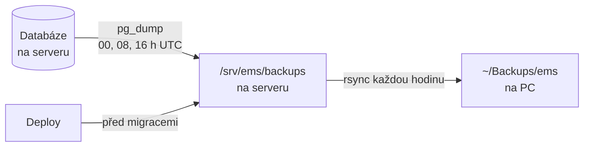

# Zálohy databáze

Databáze se zálohuje třikrát denně na serveru a záloha se každou hodinu
stahuje na PC. Tento dokument popisuje, jak to funguje, jak to nainstalovat,
jak ověřit, že zálohy běží, a hlavně jak data obnovit.

## Co se zálohuje a proč

Zálohuje se celá databáze PostgreSQL s rozšířením TimescaleDB. Redis se
nezálohuje: slouží jen jako fronta úloh pro Celery a nic trvalého v něm není.

Ne všechna data jsou stejně cenná:

| Data                                                          | Co se stane při ztrátě                                                                            |
| ------------------------------------------------------------- | ------------------------------------------------------------------------------------------------- |
| `ote_spot_price`, `battery_state`, `site_energy_balance`      | **Ztracená navždy.** API OTE vrací jen dnešek a zítřek a úspory nejde zpětně dopočítat z prognóz. |
| `users`, `sites`, `site_memberships`, `devices`, `appliances` | Uživatelé je musí zadat znovu. Mění se zřídka.                                                    |
| prognózy, `*_fetch_log`, `refresh_tokens`                     | Nevadí. Prognózy se do hodiny spočítají znovu, uživatelé se jen znovu přihlásí.                   |

Rozhoduje první řádek. Historie je výsledkem diplomové práce a přibývá každou
čtvrthodinu. Při záloze každých 8 hodin se ztratí nejvýš 8 hodin historie
(32 kroků simulace). Tomuto číslu se říká **RPO** (_recovery point objective_):
kolik dat smíme v nejhorším případě ztratit.

## Jak to funguje



Záloha na serveru chrání před chybou v datech: špatnou migrací, omylem
smazanými řádky, chybou v kódu. Kopie na PC chrání před ztrátou celého serveru.

**Formát.** Zálohy jsou `pg_dump -Fc` (_custom_ formát): komprimovaný archiv,
který se obnovuje přes `pg_restore`. 17 MB databáze dá zhruba 0,5 MB zálohu,
protože dump neobsahuje indexy, jen příkazy na jejich vytvoření.

**Ověření.** Hotová záloha se celá přečte (`pg_restore -f /dev/null`). Do té
doby leží jako skrytý soubor `.….partial`, takže nedokončená záloha se nikdy
netváří jako platná a nestáhne se na PC.

**Štítky a rotace.** Název souboru nese štítek a čas v UTC, např.
`ems-scheduled-20261026T204931Z.dump`. Každý štítek se rotuje zvlášť:

| Štítek       | Kdy vzniká                  | Na serveru | Na PC              |
| ------------ | --------------------------- | ---------- | ------------------ |
| `scheduled`  | v 00:00, 08:00 a 16:00 UTC  | 9 (3 dny)  | 90 (zhruba 30 dní) |
| `pre-deploy` | při deployi, před migracemi | 3          | 10                 |

PC drží výrazně víc záloh než server. Kdyby chyba v kódu potichu kazila data a
přišlo se na to až po týdnu, všechny zálohy na serveru už by byly poškozené.

Rotuje se **podle počtu, ne podle stáří**. Když zálohy přestanou vznikat, staré
zůstanou. Při mazání „všeho staršího než 3 dny“ by po třech dnech nezbylo nic.

**Kdo k zálohám smí.** Zálohy obsahují hashe hesel a e-maily. Na serveru je
vytváří uživatel `deploy` (jediný, kdo čte `.env`) a adresář je čitelný jen pro
skupinu `deploy`, ve které je `lilian`. Na PC je adresář čitelný jen pro
vlastníka.

## Kde je co

| Soubor v [infrastructure/backup/](../../infrastructure/backup/) | Kde běží | Co dělá                                     |
| --------------------------------------------------------------- | -------- | ------------------------------------------- |
| `backup.sh`                                                     | server   | vytvoří, ověří a rotuje zálohu              |
| `ems-backup.service`, `ems-backup.timer`                        | server   | spouští `backup.sh scheduled` třikrát denně |
| `pull.sh`                                                       | PC       | stáhne zálohy přes rsync a rotuje je        |
| `ems-backup-pull.service`, `ems-backup-pull.timer`              | PC       | spouští `pull.sh` každou hodinu             |
| `restore-local.sh`                                              | PC       | nahradí lokální vývojovou databázi zálohou  |

`backup.sh` nahrává na server CI s každým deployem, spolu s
`compose.prod.yaml`. [deploy.sh](../../infrastructure/deploy.sh) ho volá před
aktualizací rozšíření a migracemi. Když záloha selže, deploy se zastaví.

Systemd jednotky se instalují jednou ručně, protože uživatel `deploy`, pod
kterým běží CI, nemá sudo.

## Instalace

Jednorázově. Na serveru až po prvním deployi, který nahraje `backup.sh`:

```bash
# soubory jednotek nahrát z repozitáře na server, pak:
sudo cp ems-backup.service ems-backup.timer /etc/systemd/system/
sudo chown root:root /etc/systemd/system/ems-backup.{service,timer}
sudo systemctl daemon-reload
sudo systemctl enable --now ems-backup.timer
```

Na PC, z kořene repozitáře. Jednotka spouští `pull.sh` přímo z repozitáře v
`~/Projects/ems`:

```bash
mkdir -p ~/.config/systemd/user
cp infrastructure/backup/ems-backup-pull.{service,timer} ~/.config/systemd/user/
systemctl --user daemon-reload
systemctl --user enable --now ems-backup-pull.timer
```

`Persistent=true` u obou timerů znamená, že běh zmeškaný kvůli vypnutému serveru
nebo PC proběhne hned po zapnutí.

## Kontrola, že zálohy běží

Zálohy nikoho neupozorní, když selžou. Je potřeba se občas podívat.

Na serveru:

```bash
systemctl list-timers ems-backup.timer      # kdy proběhne další záloha
sudo journalctl -u ems-backup -n 20         # výsledek posledních běhů
ls -la /srv/ems/backups
```

Na PC (pozor na `--user` a bez `sudo`):

```bash
systemctl --user list-timers ems-backup-pull.timer
journalctl --user -u ems-backup-pull -n 20
ls -la ~/Backups/ems
```

Úspěšná záloha píše do logu `Backed up to …`, stažení `Newest: …`. Varování
`pg_dump: warning: there are circular foreign-key constraints on this table:
continuous_agg` se objevuje při každé záloze. Je to známé chování TimescaleDB a
u plné zálohy nevadí.

Ruční záloha mimo plán:

```bash
sudo systemctl start ems-backup.service
```

## Obnova do lokální databáze

Hodí se pro vývoj nad produkčními daty a zároveň je to zkouška, že zálohy jdou
obnovit. Z kořene repozitáře:

```bash
bash infrastructure/backup/restore-local.sh            # nejnovější záloha z ~/Backups/ems
bash infrastructure/backup/restore-local.sh <soubor>   # konkrétní záloha
```

**Lokální databáze se celá smaže.** Skript pracuje jen s `compose.yaml`, do
produkce nesáhne. Postupně:

1. zastaví `server`, `celery-worker` a `celery-beat`,
2. smaže a znovu vytvoří databázi,
3. obnoví zálohu postupem pro TimescaleDB (viz níže),
4. smaže `refresh_tokens` (podepsané produkčním klíčem, lokálně k ničemu),
5. spustí migrace novější než záloha,
6. znovu nastartuje služby.

Přihlašuje se pak produkčním heslem. Lokální Celery začne psát vlastní historii,
takže se lokál od produkce postupně rozejde.

## Obnova na produkci

Krizový postup, když jsou produkční data poškozená nebo ztracená. Všechny
příkazy se spouští na serveru v `/srv/ems` jako `lilian`.

### 1. Vybrat zálohu

```bash
ls -la /srv/ems/backups
```

Pokud je server pryč, nejdřív se zprovozní nový (deploy založí stack i
`/srv/ems/backups`) a záloha se na něj nahraje z PC:

```bash
scp ~/Backups/ems/<soubor>.dump lilian@lilianluca.com:~/
```

Do příkazů níže se pak místo `backups/<soubor>.dump` dosadí `~/<soubor>.dump`.

### 2. Zastavit aplikaci a zálohovat současný stav

Současný stav se zazálohuje i poškozený. Kdyby obnova dopadla špatně, je kam se
vrátit.

```bash
sudo docker compose -f compose.prod.yaml stop server celery-worker celery-beat
sudo -u deploy bash /srv/ems/backup.sh pre-deploy
```

### 3. Obnovit

```bash
compose() { sudo docker compose -f compose.prod.yaml "$@"; }

# Nová prázdná databáze
compose exec -T db sh -c 'psql -X -v ON_ERROR_STOP=1 -U "$POSTGRES_USER" -d postgres \
    -c "DROP DATABASE IF EXISTS \"$POSTGRES_DB\" WITH (FORCE)" \
    -c "CREATE DATABASE \"$POSTGRES_DB\""'

# Rozšíření a vypnutí triggerů TimescaleDB po dobu obnovy
compose exec -T db sh -c 'psql -X -v ON_ERROR_STOP=1 -U "$POSTGRES_USER" -d "$POSTGRES_DB" \
    -c "CREATE EXTENSION timescaledb" -c "SELECT timescaledb_pre_restore()"'

# Samotná obnova
compose cp backups/<soubor>.dump db:/tmp/restore.dump
compose exec -T db sh -c 'pg_restore --no-owner --no-privileges --exit-on-error \
    -U "$POSTGRES_USER" -d "$POSTGRES_DB" /tmp/restore.dump'
compose exec -T db rm /tmp/restore.dump

# Zapnutí triggerů zpět
compose exec -T db sh -c 'psql -X -v ON_ERROR_STOP=1 -U "$POSTGRES_USER" -d "$POSTGRES_DB" \
    -c "SELECT timescaledb_post_restore()" -c "ANALYZE"'
```

`refresh_tokens` se na produkci nemažou: klíč je stejný, takže uživatelé
zůstanou přihlášení.

### 4. Migrace a start

```bash
compose run --rm migrate
compose up -d
```

Migrace doženou schéma, pokud je záloha starší než nasazený kód. Pak se ověří,
že aplikace běží (`https://ems.lilianluca.com/api/v1/health`) a že data na
dashboardu končí v čase zálohy.

### Proč `timescaledb_pre_restore` a `post_restore`

TimescaleDB si vede vlastní katalog hypertabulek a jejich chunků v běžných
tabulkách, které pg_restore obnovuje jako všechna ostatní data. Rozšíření ale
na zápisy do svých tabulek za běžného provozu reaguje. `pre_restore` ho pro
databázi přepne do režimu obnovy, ve kterém do ničeho nezasahuje, a zastaví jeho
úlohy na pozadí. `post_restore` ho vrátí do běžného provozu.

## Verze TimescaleDB

Záloha jde obnovit jen do **stejné verze TimescaleDB**, ve které vznikla. Proto
je image v obou compose souborech zafixovaný (`timescale/timescaledb:2.31.0-pg18`)
místo `latest-pg18`, který se při každém deployi mohl tiše změnit.

Image obsahuje knihovnu, ale rozšíření v databázi zůstává ve verzi, ve které
bylo vytvořeno. `deploy.sh` proto po startu databáze spouští
`ALTER EXTENSION timescaledb UPDATE`, aby se obojí srovnalo.

Při povýšení verze:

1. Změnit tag v `compose.yaml` i `compose.prod.yaml` současně.
2. Po deployi je produkce na nové verzi. Lokálně spustit
   `ALTER EXTENSION timescaledb UPDATE` (jako první příkaz v `psql -X`).
3. Zálohy ze starší verze se obnovují do rozšíření ve **staré** verzi
   (`CREATE EXTENSION timescaledb VERSION '2.31.0'` místo
   `CREATE EXTENSION timescaledb`) a teprve po `timescaledb_post_restore()` se
   rozšíření povýší přes `ALTER EXTENSION timescaledb UPDATE`.

## Omezení

- **Bez upozornění.** O selhání zálohy se nikdo nedozví, dokud se nepodívá do
  logu. Řešením by byl ping na službu typu healthchecks.io.
- **Kopie na PC závisí na PC.** Když je PC dlouho vypnuté, je nejnovější kopie
  mimo server stejně stará.
- **Zálohy nejsou šifrované.** Na PC leží v čitelné podobě. Chrání je jen
  oprávnění adresáře a případné šifrování disku.
- **Server i jeho zálohy jsou u jednoho poskytovatele.** Mimo Hetzner je jen
  kopie na PC.
