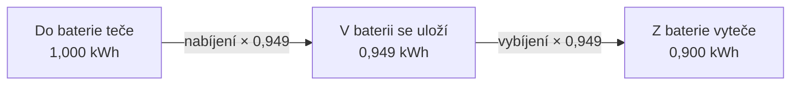

# Model baterie

Model baterie odpovídá na otázku: **když baterie nabíjí nebo vybíjí daným
výkonem, kolik energie v ní bude za čtvrthodinu?**

Používají ho dvě části systému a obě musí dojít ke stejnému výsledku:

- **plán** podle něj počítá, kam se baterie dostane, když udělá to, co navrhuje,
- **simulace** podle něj posouvá stav baterie z jedné čtvrthodiny do druhé.

Kdyby každá počítala jinak, plán by plánoval jinou baterii, než jaká se pak
simuluje.

## Co o baterii víme

Každá baterie má v aplikaci tyto parametry. Zadávají se ve formuláři baterie a
najdeš je v datovém listu.

| Parametr            | Příklad | Jednotka | Význam                         |
| ------------------- | ------- | -------- | ------------------------------ |
| Kapacita            | 10      | kWh      | kolik energie baterie pojme    |
| Minimální nabití    | 10      | %        | pod tuto úroveň se nevybíjí    |
| Maximální nabití    | 95      | %        | nad tuto úroveň se nenabíjí    |
| Max. nabíjecí výkon | 5       | kW       | jak rychle umí nabíjet         |
| Max. vybíjecí výkon | 5       | kW       | jak rychle umí vybíjet         |
| Účinnost cyklu      | 90      | %        | kolik uložené energie se vrátí |

Příklady v tomto dokumentu počítají s baterií z tabulky. Všechna čísla jsou
spočítaná funkcemi z kódu.

## Stav nabití

Stav nabití říká, kolik energie v baterii právě je. Dá se vyjádřit dvěma
způsoby:

- **v kilowatthodinách**, například 4 kWh. S tím počítá model.
- **v procentech kapacity**, například 40 %. To se ukazuje uživateli.

$$
\text{stav v procentech} = \frac{\text{stav v kWh}}{\text{kapacita v kWh}} \times 100
$$

V angličtině se stavu nabití říká _state of charge_, zkráceně **SoC**. V kódu se
tato zkratka objevuje často.

### Meze

Baterie se nepoužívá od nuly do plna. Úplné vybití i trvalé nabití na 100 % jí
škodí, proto má nastavenou spodní a horní mez:

$$
E_{\min} = \text{kapacita} \times \text{minimální nabití}
\qquad
E_{\max} = \text{kapacita} \times \text{maximální nabití}
$$

Pro baterii z příkladu:

- spodní mez: 10 × 0,10 = **1,0 kWh**,
- horní mez: 10 × 0,95 = **9,5 kWh**,
- **využitelná kapacita** je rozdíl: 9,5 − 1,0 = **8,5 kWh**.

Z desetikilowatthodinové baterie se tedy reálně používá jen 8,5 kWh.

## Účinnost

Baterie není dokonalá. Část energie se při nabíjení i vybíjení ztratí jako
teplo. **Účinnost cyklu** říká, kolik se vrátí z toho, co se do baterie poslalo.
Účinnost 90 % znamená: pošleš 1 kWh, dostaneš zpět 0,9 kWh.

Datový list uvádí jedno číslo za celý cyklus. Model ale potřebuje vědět, kolik se
ztratí při nabíjení a kolik při vybíjení. Rozdělí tedy ztrátu rovnoměrně na obě
poloviny:

$$
\eta = \sqrt{\eta_{\text{cyklus}}}
$$

Odmocnina proto, že se účinnost nabíjení a vybíjení násobí a dohromady musí dát
účinnost cyklu. Pro 90 % vyjde účinnost jednoho směru 0,949 (protože
0,949 × 0,949 = 0,9), tedy asi 5 % ztráta při nabíjení a 5 % při vybíjení.

### Co znamená výkon nabíjení a vybíjení

Výkon se vždy měří **na straně domu**, ne uvnitř baterie:

- **nabíjecí výkon** je to, co baterie z domu odebírá. Uloží se z toho méně.
- **vybíjecí výkon** je to, co baterie do domu dodává. Z baterie kvůli tomu ubude
  víc.

Díky tomu se dá výkon baterie přímo sčítat s výrobou a spotřebou domu.

## Jak se stav nabití změní za jeden krok

$$
E_{\text{nový}} = E + \left(P_{\text{nab}} \times \eta - \frac{P_{\text{vyb}}}{\eta}\right) \times \Delta t
$$

| Symbol           | Význam                           | Jednotka |
| ---------------- | -------------------------------- | -------- |
| $E$              | stav nabití na začátku kroku     | kWh      |
| $P_{\text{nab}}$ | nabíjecí výkon                   | kW       |
| $P_{\text{vyb}}$ | vybíjecí výkon                   | kW       |
| $\eta$           | účinnost jednoho směru           | –        |
| $\Delta t$       | délka kroku, čtvrthodina je 0,25 | h        |

Při nabíjení se výkon účinností **násobí**: uloží se méně, než přiteklo. Při
vybíjení se výkon účinností **dělí**: ubude víc, než odteklo.

### Příklad: nabíjení

V baterii jsou 4 kWh. Čtvrthodinu nabíjí výkonem 2 kW.

| Krok           | Výpočet     | Výsledek      |
| -------------- | ----------- | ------------- |
| Energie z domu | 2 × 0,25    | 0,5 kWh       |
| Uloží se       | 0,5 × 0,949 | 0,474 kWh     |
| Nový stav      | 4 + 0,474   | **4,474 kWh** |

### Příklad: vybíjení

V baterii je 4,474 kWh. Čtvrthodinu vybíjí výkonem 1,5 kW.

| Krok            | Výpočet       | Výsledek      |
| --------------- | ------------- | ------------- |
| Energie do domu | 1,5 × 0,25    | 0,375 kWh     |
| Z baterie ubude | 0,375 / 0,949 | 0,395 kWh     |
| Nový stav       | 4,474 − 0,395 | **4,079 kWh** |

## Co baterie skutečně provede

Plán baterii řekne, jakým výkonem má nabíjet nebo vybíjet. Baterie ale neprovede
cokoli. Skutečná baterie má řídicí elektroniku, která nabíjení u horní meze
zastaví, i kdyby jí někdo říkal, ať pokračuje. Model se chová stejně.

Požadovaný výkon se proto ořízne třemi limity a platí ten nejpřísnější.

### Nabíjení

$$
P_{\text{nab}} = \min\left(
P_{\text{požadovaný}},
P_{\text{max nab}},
\frac{E_{\max} - E}{\eta \times \Delta t}
\right)
$$

1. **Požadovaný výkon:** víc, než plán chce, baterie nenabíjí.
2. **Maximální nabíjecí výkon:** rychleji to baterie neumí.
3. **Volné místo:** poslední výraz je výkon, kterým by se baterie za krok
   naplnila přesně po horní mez.

### Vybíjení

$$
P_{\text{vyb}} = \min\left(
P_{\text{požadovaný}},
P_{\text{max vyb}},
\frac{(E - E_{\min}) \times \eta}{\Delta t}
\right)
$$

Třetí limit je tentokrát **energie nad spodní mezí**: výkon, kterým by se baterie
za krok vybila přesně po spodní mez.

### Příklad: baterie je skoro plná

V baterii je 9,3 kWh, horní mez je 9,5 kWh. Plán chce nabíjet 5 kW.

| Limit            | Výpočet                      | Hodnota      |
| ---------------- | ---------------------------- | ------------ |
| Požadovaný výkon |                              | 5 kW         |
| Maximální výkon  |                              | 5 kW         |
| Volné místo      | (9,5 − 9,3) / (0,949 × 0,25) | **0,843 kW** |

Baterie nabíjí jen **0,843 kW** a skončí přesně na 9,5 kWh.

### Příklad: baterie je skoro prázdná

V baterii je 1,2 kWh, spodní mez je 1,0 kWh. Plán chce vybíjet 3 kW.

| Limit            | Výpočet                    | Hodnota      |
| ---------------- | -------------------------- | ------------ |
| Požadovaný výkon |                            | 3 kW         |
| Maximální výkon  |                            | 5 kW         |
| Energie nad mezí | (1,2 − 1,0) × 0,949 / 0,25 | **0,759 kW** |

Baterie dodá jen **0,759 kW** a skončí přesně na 1,0 kWh.

### Příklad: plán chce víc, než baterie umí

Plán chce nabíjet 8 kW, baterie má maximální nabíjecí výkon 5 kW. Nabíjí
**5 kW**.

### Co se stane se zbytkem

Model baterie o síti nic neví. Jen vrátí výkon, který baterie skutečně provede.
Co se stane s energií, kterou baterie nepřijala nebo nedodala, vyplyne až z
bilance domu:

$$
\text{zbytek} = \text{výroba} - \text{spotřeba} - P_{\text{nab}} + P_{\text{vyb}}
$$

Kladný zbytek odteče do sítě, záporný se ze sítě odebere. Nikdo o tom
nerozhoduje: elektřina, kterou dům vyrobí a nespotřebuje ani neuloží, nemá kam
jinam jít.

V prvním příkladu výše tedy baterie vezme místo 5 kW jen 0,843 kW a o zbylých
4,157 kW se zvětší dodávka do sítě. Ve druhém dodá místo 3 kW jen 0,759 kW a
zbylých 2,241 kW se koupí ze sítě.

Tento výpočet je součástí bilance čtvrthodiny a popisuje ho dokument
o [úsporách](uspory.md).

### Proč se to zaznamenává takhle

Do historie se ukládá výkon, který baterie skutečně provedla, ne ten, který plán
požadoval. Kdyby se uložil požadavek, další krok by vycházel ze stavu, do kterého
se baterie nikdy nedostala.

## Stav baterie mezi dvěma záznamy

Stav baterie se zapisuje jednou za čtvrthodinu. Každý záznam obsahuje stav nabití
a výkon, kterým baterie od té chvíle poběží. Když se někdo zeptá na stav v jiný
okamžik, dopočítá se z posledního záznamu.

Platí přitom dvě pravidla:

1. **Uvnitř kroku se stav mění rovnoměrně.** Po pěti minutách z patnácti je
   provedená třetina změny.
2. **Výkon platí nejvýš jeden krok.** Když další záznam nepřijde, baterie po
   čtvrthodině přestane a stojí.

Druhé pravidlo je pojistka. Záznam chybí, když neproběhl výpočet, který by
baterii řekl, co dál. Baterie bez pokynu nemá donekonečna opakovat ten poslední.

### Příklad

Ve 12:00 je v baterii 4 kWh a začíná nabíjet 2 kW.

| Čas   | Stav      | Proč                      |
| ----- | --------- | ------------------------- |
| 12:00 | 4,000 kWh | okamžik záznamu           |
| 12:05 | 4,158 kWh | třetina kroku             |
| 12:15 | 4,474 kWh | celý krok                 |
| 13:00 | 4,474 kWh | po 12:15 už baterie stojí |

## Odkud začíná plán

Plán potřebuje vědět, kolik energie je v baterii na začátku. Určí se takto:

- **Existuje záznam mladší než jeden den:** vezme se stav dopočítaný z něj.
- **Záznam neexistuje nebo je starší:** baterie se bere jako vybitá na spodní
  mez. Je to opatrný předpoklad: plán nepočítá s energií, o které neví, jestli
  tam je.

Výsledek se navíc **srovná do povoleného rozsahu**. Stav může být mimo meze,
například když ho někdo zadal ručně nebo když se meze změnily. Plán, který by
začínal nad horní mezí, by odporoval vlastním pravidlům a nemusel by mít řešení.

| Zaznamenaný stav          | Plán začíná z        |
| ------------------------- | -------------------- |
| žádný                     | 1,0 kWh (spodní mez) |
| 9,8 kWh (nad horní mezí)  | 9,5 kWh              |
| 0,5 kWh (pod spodní mezí) | 1,0 kWh              |

## Kapacita se opotřebením zmenšuje

Kapacita v tomto dokumentu není napořád stejná. Baterie používáním stárne a
pojme čím dál méně. Model proto nepočítá s kapacitou z datového listu, ale s
**efektivní kapacitou**, která je o opotřebení nižší. Meze v kilowatthodinách se
počítají z ní.

Jak se efektivní kapacita určuje, popisuje dokument o
[zdraví baterie](zdravi-baterie.md).

## Kde to je v kódu

| Co                             | Kde                                                                                               |
| ------------------------------ | ------------------------------------------------------------------------------------------------- |
| Parametry baterie a meze v kWh | `BatterySpec` v [optimization/model.py](../../server/src/optimization/model.py)                   |
| Oříznutí výkonu limity         | `feasible_setpoint` v [simulation/battery_model.py](../../server/src/simulation/battery_model.py) |
| Změna stavu za krok            | `advance_state_of_charge` tamtéž                                                                  |
| Stav v libovolný okamžik       | `state_of_charge_at` tamtéž                                                                       |
| Počáteční stav plánu           | `starting_state_of_charge` tamtéž                                                                 |
| Zápis a čtení stavu            | [devices/battery_state.py](../../server/src/devices/battery_state.py)                             |
| Testy                          | [tests/test_battery_model.py](../../server/tests/test_battery_model.py)                           |

## Předpoklady a omezení

- **Účinnost je konstantní.** Ve skutečnosti závisí na výkonu, teplotě a stavu
  nabití. Model má jedno číslo pro všechny situace.
- **Ztráty jsou rozdělené napůl.** Datový list neříká, kolik se ztratí při
  nabíjení a kolik při vybíjení. Rovnoměrné rozdělení je předpoklad, ne změřená
  vlastnost.
- **Účinnost zahrnuje všechno.** Ztráty v baterii a ve střídači model nerozlišuje.
- **Maximální výkon je stále stejný.** Skutečná baterie nabíjení zpomaluje, když
  se blíží plnému nabití. Model nabíjí plným výkonem až po horní mez.
- **Baterie se sama nevybíjí.** Samovybíjení je u domácích baterií malé a model
  ho zanedbává.
- **Výkon je po celý krok stejný.** Uvnitř čtvrthodiny se nemění.
- **Teplota nehraje roli.** V mrazu baterie ve skutečnosti nabíjí pomaleji nebo
  vůbec.
