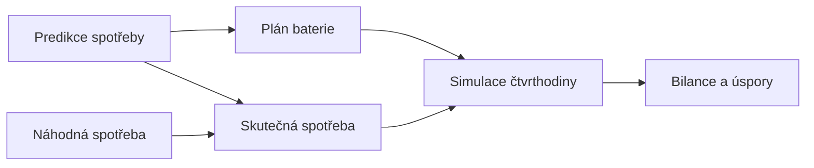

# Náhodná spotřeba

Náhodná spotřeba je **neplánovaná spotřeba, kterou domácnost nemůže odložit.**
Třeba nemocné dítě a praní navíc, trouba pro nečekané hosty nebo vysoušeč vlasů.
Nikdo ji nepředpoví a žádný [režim úspor](rezim-uspor.md) ji nevypne, protože
jde o věci, které se udělat musí.

## K čemu je

Bez ní systém bere [predikci spotřeby](spotreba.md) zároveň jako skutečnost.
[Simulace](simulace.md) zapíše do bilance přesně to, co predikce čekala, takže
plán baterie vždycky „ví", co se stane. Úspory pak vycházejí ideálně.

Náhodná spotřeba vnáší do simulace rozdíl mezi predikcí a skutečností. Ukáže,
kolik stojí, když realita nevyjde podle plánu, a dá se na ní porovnat, jak si s
tím poradí [plán podle pravidel](plan-rule-based.md) a
[plán optimalizací](plan-lp.md).

## Kam patří

**Do skutečnosti v simulaci, ne do predikce.**

- **Predikce se nemění.** Náhodnou událost z principu předpovědět nejde, a kdyby
  o ní plán věděl, nebyla by to náhoda.
- **Plán o náhodě neví.** Počítá z predikce a řídí jen baterii.
- **Simulace přičte náhodnou spotřebu k predikované.** Výsledkem je skutečná
  spotřeba, ze které se počítá bilance čtvrthodiny a úspory.
- **Přičítá se k omezené i neomezené spotřebě**, protože ji žádný režim úspor
  nevypíná.

## Výpočet

Celý výpočet je jedno pravidlo:

> V každé čtvrthodině mezi 6:00 a 22:00 je **šance 3 %**, že domácnost
> spotřebuje navíc **2 kW**.

Pro každou takovou čtvrthodinu se „hodí kostkou": vylosuje se náhodné číslo od 0
do 1. Je-li menší než 0,03, přičte se 2 kW, jinak nic.

| Konstanta | Hodnota       | Význam                                      |
| --------- | ------------- | ------------------------------------------- |
| Šance     | 3 %           | jak pravděpodobná je událost v čtvrthodině  |
| Výkon     | 2 kW          | kolik událost odebírá                       |
| Doba      | 6:00 až 22:00 | kdy může událost nastat, v pražském čase    |

Hodnoty jsou náš odhad, zdroj pro ně nemáme. Odpovídají zhruba dvěma
krátkým během běžného spotřebiče navíc za den, třeba trouby nebo varné desky.

Noc je vynechaná, protože neodložitelné věci se dělají, když je domácnost
vzhůru. Každá událost trvá jednu čtvrthodinu. Když padnou dvě čtvrthodiny po
sobě, vznikne delší událost sama od sebe.

### Kolik je to průměrně

Mezi 6:00 a 22:00 je 64 čtvrthodin:

$$
64 \times 0{,}03 \approx 1{,}9\ \text{události za den}
$$

$$
1{,}9 \times 2\ \text{kW} \times 0{,}25\ \text{h} \approx 1\ \text{kWh za den}
$$

Počet událostí se ale den ode dne liší. Kontrolní výpočet přes deset let
vylosovaných dní:

| Událostí za den | 0    | 1    | 2    | 3    | 4   | 5 a víc |
| --------------- | ---- | ---- | ---- | ---- | --- | ------- |
| Podíl dní       | 14 % | 27 % | 29 % | 17 % | 9 % | 4 %     |

Průměr vyšel 1,95 události a 0,97 kWh za den, nejvíc bylo 8 událostí za den.

### Stejný den, stejná náhoda

Losování vychází ze **semínka složeného z lokality a dne**. Stejná lokalita má
pro stejný den vždycky stejné události. Výsledky simulace tak jde zopakovat, a
když se čtvrthodina simuluje podruhé, dostane stejnou hodnotu jako poprvé.

Různé lokality mají různé události, protože domácnosti na sobě nezávisí.

## Co náhoda udělá s úsporami

Baterie jede podle plánu a na náhodu nereaguje. Co plán nepokryje, dokoupí se ze
sítě. Jestli to úsporu baterie změní, záleží na tom, co baterie zrovna dělá.

Příklad pro spotovou cenu 2 500 Kč/MWh (nákup 5,57 Kč/kWh, prodej 2,50 Kč/kWh).
Spočítáno funkcí `step_balance`:

| Čtvrthodina                               | Náklad s baterií | Náklad bez baterie | Úspora baterie |
| ----------------------------------------- | ---------------: | -----------------: | -------------: |
| Odpoledne: přebytek 2 kW jde do baterie   |          0,00 Kč |           −1,25 Kč |       −1,25 Kč |
| Totéž s náhodnou událostí                 |          2,78 Kč |            0,00 Kč |       −2,78 Kč |
| Večer: baterie pokrývá spotřebu 1,5 kW    |          0,00 Kč |            2,09 Kč |        2,09 Kč |
| Totéž s náhodnou událostí                 |          2,78 Kč |            4,87 Kč |        2,09 Kč |

- **Odpoledne náhoda baterii ublíží.** Bez baterie by událost spotřebovala
  přebytek, který by se jinak levně prodal. Baterie ale přebytek podle plánu
  nabíjí dál, a událost se proto musí draze koupit ze sítě.
- **Večer na úsporu nemá vliv.** Událost se koupí ze sítě s baterií i bez ní,
  takže stojí v obou případech stejně.

## Co se ukládá

Do bilance čtvrthodiny (`site_energy_balance`) se uloží skutečná spotřeba,
tedy predikce plus náhoda. K tomu přibude sloupec `unplanned_load_kw` se
samotnou náhodnou spotřebou.

Stránka Úspory ukazuje energii z tohoto sloupce: součet za měsíc v hlavičce a
hodnotu dne v popisku sloupce grafu. API ji vrací v denních součtech jako
`unplannedEnergyKwh`. Náklady a úspory náhodu už obsahují, tento údaj jen
ukazuje, kolik jí bylo.

Predikce (`load_forecast`) a graf predikce na přehledu se nemění.

## Příklad

Lokalita 1, čtyři listopadové dny:

| Den              | Události (začátek čtvrthodiny) | Energie navíc |
| ---------------- | ------------------------------ | ------------: |
| pondělí 9. 11.   | 7:30, 10:45                    |       1,0 kWh |
| úterý 10. 11.    | 15:30                          |       0,5 kWh |
| středa 11. 11.   | 16:45, 20:45                   |       1,0 kWh |
| čtvrtek 12. 11.  | žádná                          |         0 kWh |

V úterý v 15:30 třeba domácnost odebírá o 2 kW víc, než čekala predikce, a
plán baterie o tom neví.

## Kde v kódu

| Co                        | Kde                                                                                                                             |
| ------------------------- | ------------------------------------------------------------------------------------------------------------------------------- |
| Konstanty                 | `CHANCE`, `POWER_KW`, `FIRST_HOUR`, `LAST_HOUR` v [simulation/unplanned_load.py](../../server/src/simulation/unplanned_load.py) |
| Losování dne              | `unplanned_day_kw` tamtéž                                                                                                       |
| Hodnota jedné čtvrthodiny | `unplanned_load_kw` tamtéž                                                                                                      |
| Přičtení ke spotřebě      | `_record_balance` v [simulation/battery_simulation.py](../../server/src/simulation/battery_simulation.py)                       |
| Sloupec v bilanci         | `unplanned_load_kw` v [savings/models.py](../../server/src/savings/models.py)                                                   |
| Testy                     | [tests/test_unplanned_load.py](../../server/tests/test_unplanned_load.py)                                                       |

## Předpoklady a omezení

- **Baterie na náhodu nereaguje.** Skutečný střídač by při nečekané spotřebě
  přestal nabíjet nebo začal vybíjet. Simulovaná baterie drží nastavení z plánu
  až do další čtvrthodiny a stav jejího nabití náhoda neovlivní.
- **Parametry jsou odhad** a jsou stejné pro všechny lokality. Skutečná
  domácnost může mít neplánované spotřeby víc nebo méně.
- **Událost má vždy 2 kW.** Skutečné spotřebiče mají různé příkony.
- **Náhoda jen přidává.** Skutečná spotřeba může být i nižší, než predikce
  čekala, třeba když nikdo není doma. To model nezná.
- **Čtvrthodiny jsou nezávislé** na sobě, na čase v roce i na dni v týdnu.
- **Dny, které už jsou nasimulované, se nepřepočítají.** Náhoda začne platit od
  první čtvrthodiny po nasazení.
