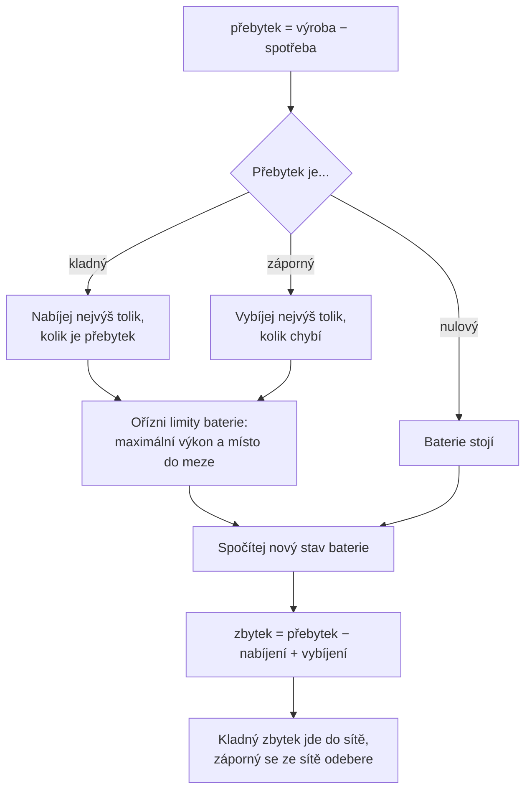

# Plán podle pravidel

Plán říká, co má baterie dělat v každé čtvrthodině: nabíjet, vybíjet, nebo stát.
Systém umí plán sestavit dvěma způsoby. Tento dokument popisuje ten jednodušší,
**plán podle pravidel**. Druhý, [plán optimalizací](plan-lp.md), je popsaný
zvlášť.

V současnosti systém používá právě plán podle pravidel.

## Myšlenka

Pravidla jsou dvě a rozhodují v každé čtvrthodině znovu:

1. **Je přebytek?** Ulož ho do baterie. Co se nevejde, pošli do sítě.
2. **Je nedostatek?** Pokryj ho z baterie. Co baterie nedá, kup ze sítě.

Této strategii se říká **maximalizace vlastní spotřeby**. Domácnost se snaží
spotřebovat co nejvíc toho, co sama vyrobila, a ze sítě brát co nejméně.

Proč to šetří peníze, vysvětluje dokument o [cenách](ceny.md): kilowatthodina ze
sítě stojí výrazně víc, než kolik domácnost dostane za kilowatthodinu, kterou do
sítě prodá.

Pravidlo se přitom **nedívá na ceny ani dopředu**. V každém kroku ho zajímá jen
to, jestli je teď přebytek, nebo nedostatek. To je jeho síla i slabina a vrátíme
se k tomu níže.

## Vstupy a výstupy

Pro každou čtvrthodinu horizontu plán dostane:

| Vstup             | Jednotka | Odkud                            |
| ----------------- | -------- | -------------------------------- |
| Predikce výroby   | kW       | [predikce výroby](fve-vyroba.md) |
| Predikce spotřeby | kW       | [predikce spotřeby](spotreba.md) |
| Nákupní cena      | Kč/kWh   | [ceny](ceny.md)                  |
| Prodejní cena     | Kč/kWh   | [ceny](ceny.md)                  |

A jednou pro celý horizont:

| Vstup                   | Jednotka | Odkud                             |
| ----------------------- | -------- | --------------------------------- |
| Parametry baterie       | –        | [model baterie](model-baterie.md) |
| Stav baterie na začátku | kWh      | [model baterie](model-baterie.md) |
| Limit přípojky          | kW       | nastavení systému, 17 kW          |

Pro každou čtvrthodinu plán vrátí:

| Výstup                      | Jednotka |
| --------------------------- | -------- |
| Nabíjecí výkon              | kW       |
| Vybíjecí výkon              | kW       |
| Odběr ze sítě               | kW       |
| Dodávka do sítě             | kW       |
| Stav baterie na konci kroku | kWh      |

A k tomu tři čísla za celý horizont: **náklad s plánem**, **náklad bez baterie**
a jejich rozdíl, **odhadovanou úsporu**.

Ceny pravidlo k rozhodování nepotřebuje. Slouží jen k výpočtu nákladu.

## Odkud kam plán sahá

Horizont plánu je řada čtvrthodin, která:

- **začíná aktuální čtvrthodinou**, protože minulost naplánovat nejde,
- **končí tam, kde končí data.** Zahrne jen čtvrthodiny, pro které je známá cena
  i predikce. Dopoledne je to konec dneška, odpoledne po zveřejnění zítřejších
  cen konec zítřka.

Horizont se tedy během dne zkracuje a odpoledne skokem prodlouží.

## Rozhodnutí v jednom kroku

### Krok 1: přebytek

$$
\text{přebytek} = \text{výroba} - \text{spotřeba}
$$

### Krok 2: kolik baterie udělá

Při přebytku baterie nabíjí. Výkon je nejmenší ze tří hodnot:

$$
P_{\text{nab}} = \min\left(
\text{přebytek},
P_{\text{max nab}},
\frac{E_{\max} - E}{\eta \times \Delta t}
\right)
$$

Při nedostatku baterie vybíjí, opět nejmenší ze tří hodnot:

$$
P_{\text{vyb}} = \min\left(
\text{nedostatek},
P_{\text{max vyb}},
\frac{(E - E_{\min}) \times \eta}{\Delta t}
\right)
$$

Jsou to stejné limity jako v [modelu baterie](model-baterie.md). Jediný rozdíl
je v prvním členu: místo požadovaného výkonu je tam přebytek nebo nedostatek.
Baterie tedy **nikdy nenabíjí ze sítě a nikdy do sítě nevybíjí**.

### Krok 3: nový stav baterie

$$
E_{\text{nový}} = E + \left(P_{\text{nab}} \times \eta - \frac{P_{\text{vyb}}}{\eta}\right) \times \Delta t
$$

Tento stav je výchozím stavem pro další krok.

### Krok 4: co jde přes síť

$$
\text{zbytek} = \text{přebytek} - P_{\text{nab}} + P_{\text{vyb}}
$$

Kladný zbytek je dodávka do sítě, záporný je odběr ze sítě.

## Příklad: den v osmi krocích

Pro přehlednost má příklad **hodinové kroky** místo čtvrthodinových a z celého
dne vybírá osm hodin. Výpočet je jinak stejný. Čísla jsou spočítaná funkcí z
kódu.

Baterie: 10 kWh, rozsah 10–95 %, výkon 5 kW, účinnost cyklu 90 %. Na začátku je
vybitá na spodní mez, tedy 1,0 kWh.

| Hodina | Výroba | Spotřeba | Nabíjení | Vybíjení | Ze sítě | Do sítě | Stav baterie |
| ------ | -----: | -------: | -------: | -------: | ------: | ------: | -----------: |
| 6      |      0 |        1 |        – |        – |    1,00 |       – |         1,00 |
| 9      |      2 |        1 |     1,00 |        – |       – |       – |         1,95 |
| 11     |      6 |        1 |     5,00 |        – |       – |       – |         6,69 |
| 13     |      7 |        1 |     2,96 |        – |       – |    3,04 |         9,50 |
| 15     |      4 |        1 |        – |        – |       – |    3,00 |         9,50 |
| 18     |      0 |        3 |        – |     3,00 |       – |       – |         6,34 |
| 20     |      0 |        4 |        – |     4,00 |       – |       – |         2,12 |
| 22     |      0 |        2 |        – |     1,06 |    0,94 |       – |         1,00 |

Výkony jsou v kW, stav baterie v kWh na konci hodiny.

Co se v jednotlivých hodinách děje:

- **6 h:** nedostatek 1 kW, ale baterie je na spodní mezi. Všechno se koupí.
- **9 h:** přebytek 1 kW jde celý do baterie. Uloží se z něj 0,95 kWh.
- **11 h:** přebytek 5 kW, baterie nabíjí naplno.
- **13 h:** přebytek 6 kW. Do horní meze zbývá místo jen na 2,96 kW, zbylých
  3,04 kW jde do sítě.
- **15 h:** baterie je plná, celý přebytek 3 kW jde do sítě.
- **18 a 20 h:** baterie pokrývá celou spotřebu.
- **22 h:** v baterii zbývá nad spodní mezí energie jen na 1,06 kW, zbylých
  0,94 kW se koupí.

## Náklad a odhadovaná úspora

Když je plán hotový, spočítá se, kolik by stál:

$$
\text{náklad} = \sum_{\text{kroky}} \left(
P_{\text{ze sítě}} \times c_{\text{nákup}} - P_{\text{do sítě}} \times c_{\text{prodej}}
\right) \times \Delta t
$$

Za odběr se platí, za dodávku se dostává. Proto má dodávka znaménko minus.

Stejně se spočítá **náklad bez baterie**: tedy kdyby se každý přebytek rovnou
prodal a každý nedostatek rovnou koupil.

$$
\text{odhadovaná úspora} = \text{náklad bez baterie} - \text{náklad s plánem}
$$

### Příklad pokračuje

Ke každé hodině přidáme spotovou cenu a z ní nákupní a prodejní cenu:

| Hodina | Spot [Kč/MWh] | Nákup [Kč/kWh] | Prodej [Kč/kWh] |
| ------ | ------------: | -------------: | --------------: |
| 6      |         3 000 |           6,17 |            3,00 |
| 9      |         2 000 |           4,96 |            2,00 |
| 11     |         1 000 |           3,75 |            1,00 |
| 13     |           500 |           3,15 |            0,50 |
| 15     |         1 000 |           3,75 |            1,00 |
| 18     |         5 000 |           8,59 |            5,00 |
| 20     |         6 000 |           9,80 |            6,00 |
| 22     |         4 000 |           7,38 |            4,00 |

Náklad s plánem se skládá ze čtyř hodin, kdy něco šlo přes síť:

| Hodina | Co se stalo         | Výpočet      |       Kč |
| ------ | ------------------- | ------------ | -------: |
| 6      | odběr 1,00 kWh      | 1,00 × 6,17  |     6,17 |
| 13     | dodávka 3,04 kWh    | −3,04 × 0,50 |    −1,52 |
| 15     | dodávka 3,00 kWh    | −3,00 × 1,00 |    −3,00 |
| 22     | odběr 0,94 kWh      | 0,94 × 7,38  |     6,91 |
|        | **Náklad s plánem** |              | **8,56** |

Bez baterie by se v každé hodině celý přebytek prodal a celý nedostatek koupil.
Vyšlo by to na **72,91 Kč**. Většinu tvoří večerní hodiny, kdy je elektřina
nejdražší.

$$
\text{odhadovaná úspora} = 72{,}91 - 8{,}56 = 64{,}35\ \text{Kč}
$$

## Co pravidlo neumí

Pravidlo nevidí ceny ani budoucnost. Má to dva důsledky.

### Nenabíjí ze sítě, ani když je to výhodné

Představ si dvě hodiny bez výroby. V první je elektřina levná (1 Kč/kWh) a
spotřeba žádná. Ve druhé je drahá (10 Kč/kWh) a spotřeba 2 kW.

- **Pravidlo** v první hodině nic neudělá, protože není přebytek. Ve druhé koupí
  2 kWh draze. Úspora je **0 Kč**.
- **Plán optimalizací** v první hodině levně nabije a ve druhé z baterie
  spotřebu pokryje. Úspora je **17,78 Kč**.

### Nevybírá si, kdy nabíjet a kdy prodávat

V příkladu výše pravidlo začne nabíjet hned v 9 hodin a ve 13 hodin je baterie
plná. Zbytek přebytku pak prodává ve 13 a 15 hodin, tedy v době, kdy je cena
nejnižší.

Plán optimalizací to na stejném dni udělá obráceně. V 9 a 11 hodin, kdy je cena
ještě vyšší, přebytek většinou prodává. Baterii nabije hlavně ve 13 a 15 hodin,
kdy je cena nejnižší a prodej se vyplatí nejméně. Večer se pak oba plány chovají
stejně.

|                     |   Náklad | Odhadovaná úspora |
| ------------------- | -------: | ----------------: |
| Bez baterie         | 72,91 Kč |                 – |
| Plán podle pravidel |  8,56 Kč |          64,35 Kč |
| Plán optimalizací   |  6,54 Kč |          66,37 Kč |

Na tomto dni je rozdíl malý, asi 2 Kč. Pravidlo získá většinu úspory, protože
hlavní přínos baterie je přesun přebytku do večera a to pravidlo dělá dobře.
Rozdíl roste ve dnech, kdy se cena během dne hodně mění nebo kdy je výroby málo.

## Kdy plán nevznikne

- **Lokalita nemá baterii.** Není co plánovat.
- **Chybí data.** Pro žádnou čtvrthodinu od teď dál není známá cena i predikce
  zároveň.
- **Krok přetíží přípojku.** Když by odběr nebo dodávka v některém kroku
  překročily limit přípojky, plán skončí chybou. Pravidlo neumí energii přesunout
  do jiného kroku, aby se pod limit vešlo.

Když chybí data nebo krok přetíží přípojku, simulace nechá baterii v dané
čtvrthodině stát.

## Kde to je v kódu

| Co                           | Kde                                                                                                  |
| ---------------------------- | ---------------------------------------------------------------------------------------------------- |
| Plán podle pravidel          | `rule_based_schedule` v [optimization/rule_based.py](../../server/src/optimization/rule_based.py)    |
| Náklad bez baterie           | `baseline_cost` v [optimization/model.py](../../server/src/optimization/model.py)                    |
| Sestavení horizontu a vstupů | `OptimizationService.get_plan` v [optimization/service.py](../../server/src/optimization/service.py) |
| Volba mezi oběma plány       | `SCHEDULERS` a `OptimizationService.strategy` tamtéž                                                 |
| Testy                        | [tests/test_rule_based.py](../../server/tests/test_rule_based.py)                                    |

## Předpoklady a omezení

- **Plán stojí na predikcích.** Je tak dobrý, jak dobré jsou predikce výroby a
  spotřeby. Když se spletou, plán počítá se situací, která nenastane.
- **Ceny nehrají v rozhodování roli.** Viz výše.
- **Energie, která zůstane v baterii na konci, se nepočítá.** Odhadovaná úspora
  zahrnuje jen to, co prošlo přes síť během horizontu. Když horizont skončí a
  baterie je plná, plán za nabití „zaplatil" ušlým prodejem, ale užitek z uložené
  energie přijde až po konci horizontu a do úspory se nedostane. Odhad pak může
  vyjít nízký nebo i záporný, přestože plán je v pořádku. Skutečné úspory se
  proto počítají jinak, viz [úspory](uspory.md).
- **Limit přípojky je stejný pro všechny lokality.** Je v nastavení systému, ne
  u lokality.
- **Jedna baterie na lokalitu.** Má-li lokalita víc baterií, plánuje se první.
