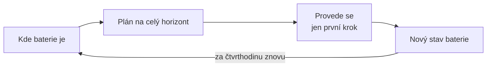
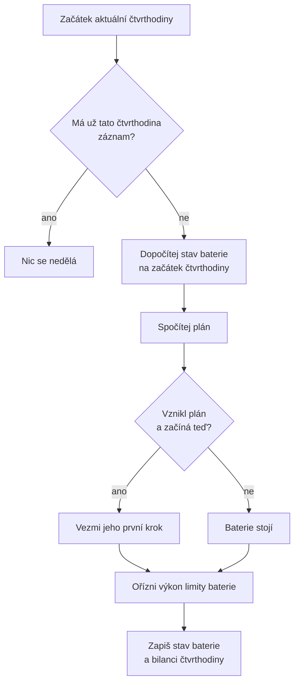

# Simulace baterie

Simulace je smyčka, která spojuje všechny ostatní výpočty. Každou čtvrthodinu
udělá za baterii to, co by ve skutečné instalaci udělal střídač: zjistí, kde
baterie je, zeptá se na plán, provede jeho první krok a zapíše výsledek.

Systém skutečný střídač neřídí. Simulace ho zastupuje, aby šlo ukázat a
vyhodnotit, co by plán s baterií dělal.

## Plánuj celý den, proveď jen první krok

Plán pokrývá celý horizont, tedy zbytek dneška a případně zítřek. Simulace z něj
ale provede **jen první čtvrthodinu**. Další čtvrthodinu se plán spočítá celý
znovu a zase se z něj provede jen první krok.



Na první pohled je to plýtvání: proč plánovat celý den a zbytek zahodit? Důvody
jsou dva.

- **Predikce se zpřesňují.** Počasí a spotřeba se přepočítávají každou hodinu a
  odpoledne přibudou zítřejší ceny. Plán z rána pracoval s horšími informacemi
  než plán z poledne.
- **Chyby se nehromadí.** Když baterie neudělá přesně to, co plán chtěl, další
  plán už vychází ze skutečného stavu, ne z toho, který si představoval ten
  předchozí.

Tomuto postupu se říká **řízení s klouzavým horizontem**, anglicky _model
predictive control_ (MPC). Horizont se s každým krokem posune o čtvrthodinu dál.

Na zbytku plánu přesto záleží. První krok je dobrý jen tehdy, když ví, co přijde
po něm. Jestli má baterie teď nabíjet, závisí na tom, jestli se uložená energie
později využije.

## Jeden krok simulace



### 1. Která čtvrthodina

Aktuální čas se zaokrouhlí dolů na začátek čtvrthodiny. Simulace spuštěná ve
12:16:03 pracuje s čtvrthodinou 12:15–12:30.

### 2. Má už čtvrthodina záznam?

Pokud ano, simulace skončí. Stejná čtvrthodina se může spustit dvakrát, například
automaticky a ručně. Druhý běh by zapsal výkon, který ten první už provádí.

### 3. Kde baterie je

Stav na začátku čtvrthodiny se dopočítá z posledního záznamu podle
[modelu baterie](model-baterie.md): poslední zaznamenaný stav a výkon, který od
té doby běžel.

Když žádný záznam z posledních 24 hodin není, bere se baterie jako vybitá na
spodní mez.

Počítá se s efektivní kapacitou, tedy sníženou o opotřebení, viz
[zdraví baterie](zdravi-baterie.md).

### 4. Co říká plán

Spočítá se plán, v současnosti [plán podle pravidel](plan-rule-based.md), a
vezme se z něj první krok: nabíjecí a vybíjecí výkon.

Baterie zůstane stát, když:

- plán nevznikl, protože chybí ceny nebo predikce,
- plán nevznikl, protože by některý krok přetížil přípojku,
- plán vznikl, ale začíná později než teď. To se stane, když chybí data právě
  pro aktuální čtvrthodinu. Takový plán neříká, co dělat teď.

Baterie bez pokynu stojí. Nehádá.

### 5. Co baterie skutečně provede

Výkon z plánu se ořízne limity baterie: maximálním výkonem a místem do horní
nebo spodní meze. Postup popisuje [model baterie](model-baterie.md).

Plán a simulace počítají stejným modelem, takže se většinou shodnou. Oříznutí je
pojistka pro případ, že se neshodnou.

### 6. Zápis

Zapisují se až dva řádky:

| Tabulka               | Co obsahuje                                                        | Kdy vzniká                                        |
| --------------------- | ------------------------------------------------------------------ | ------------------------------------------------- |
| `battery_state`       | stav baterie na začátku čtvrthodiny a výkon, který během ní poběží | vždy                                              |
| `site_energy_balance` | náklad čtvrthodiny s baterií a bez ní, viz [úspory](uspory.md)     | jen když je pro čtvrthodinu známá cena i predikce |

Stav baterie se zapíše vždy, i když baterie stojí. Bilance jen tehdy, když jde
čtvrthodinu ocenit. Přehled všech situací je [níže](#co-když-něco-chybí).

Když se zapisují oba řádky, ukládají se společně. Pokud by zápis jednoho selhal,
například kvůli výpadku databáze, neuloží se ani druhý. Nemůže tedy vzniknout
bilance pro čtvrthodinu, která nemá záznam stavu.

## Co přesně znamená jeden záznam

Záznam v `battery_state` říká dvě věci: **kolik energie je v baterii na začátku
čtvrthodiny** a **jakým výkonem baterie během ní poběží**.

Stav na konci čtvrthodiny se neukládá. Dopočítá se, až bude potřeba, z těchto
dvou údajů.

### Příklad: tři čtvrthodiny

Baterie 10 kWh, rozsah 10–95 %, účinnost cyklu 90 %. Plán chce pokaždé nabíjet
2 kW.

| Běh simulace | Stav na začátku | Zapsaný výkon | Jak stav vznikl                   |
| ------------ | --------------: | ------------- | --------------------------------- |
| 12:00        |       4,000 kWh | nabíjení 2 kW | první záznam                      |
| 12:15        |       4,474 kWh | nabíjení 2 kW | 4,000 + čtvrthodina nabíjení 2 kW |
| 12:30        |       4,949 kWh | nabíjení 2 kW | 4,474 + čtvrthodina nabíjení 2 kW |

Každý běh vezme předchozí záznam, posune stav o jednu čtvrthodinu a zapíše nový.

### Příklad: jeden běh vypadne

Simulace ve 12:30 neproběhne, například proto, že server zrovna neběžel. Další
běh přijde až ve 12:45.

| Běh simulace | Stav na začátku | Jak stav vznikl                             |
| ------------ | --------------: | ------------------------------------------- |
| 12:15        |       4,474 kWh |                                             |
| 12:30        |               – | běh vypadl                                  |
| 12:45        |       4,949 kWh | 4,474 + **jedna** čtvrthodina nabíjení 2 kW |

Od posledního záznamu uběhly dvě čtvrthodiny, ale stav se posunul jen o jednu.
Výkon ze záznamu platí nejvýš čtvrthodinu. Mezi 12:30 a 12:45 baterie stála,
protože jí nikdo neřekl, co dělat.

Pro čtvrthodinu 12:30–12:45 nevznikl záznam o stavu ani bilance. V úsporách bude
ten den o jednu čtvrthodinu neúplný.

## Co když něco chybí

| Situace                           | Co simulace udělá    | Záznam stavu | Bilance                |
| --------------------------------- | -------------------- | ------------ | ---------------------- |
| Chybí cena nebo predikce          | baterie stojí        | ano          | ne                     |
| Plán by přetížil přípojku         | baterie stojí        | ano          | ano, s nulovou úsporou |
| Čtvrthodina už záznam má          | nic                  | beze změny   | beze změny             |
| Poslední záznam je starší než den | začne od spodní meze | ano          | ano                    |
| Lokalita nemá baterii             | lokalita se přeskočí | ne           | ne                     |
| Simulace neběží                   | nic se neděje        | ne           | ne                     |

Řada stavů baterie tedy pokračuje i ve chvílích, kdy není podle čeho plánovat.
Bilance vzniká jen tehdy, když jde čtvrthodinu ocenit.

## Kdy simulace běží

Automaticky **každých 15 minut**, vždy na začátku čtvrthodiny. Jeden běh projde
všechny lokality, které mají baterii. Všechny se simulují pro stejnou
čtvrthodinu, i kdyby běh trval déle.

Predikce a ceny, ze kterých plán vychází, se počítají v jiných úlohách a v jiných
časech, viz [přehled](../prehled.md). Simulace na ně nečeká. Vezme poslední
uložené hodnoty. Hodinu stará predikce pořád dá použitelný plán.

### Ruční nastavení stavu

Pro vývoj jde stav baterie zapsat ručně z příkazové řádky:

```bash
uv run python -m src.cli set-battery-state --device-id 3 --soc-kwh 6.5
```

Zapíše se jako stav s nulovým výkonem. Další běh simulace z něj vyjde.

## Kde to je v kódu

| Co                                   | Kde                                                                                                                              |
| ------------------------------------ | -------------------------------------------------------------------------------------------------------------------------------- |
| Jeden krok simulace                  | `BatterySimulationService.simulate_step` v [simulation/battery_simulation.py](../../server/src/simulation/battery_simulation.py) |
| První krok plánu nebo stání          | `_planned_setpoint` tamtéž                                                                                                       |
| Zápis bilance                        | `_record_balance` tamtéž                                                                                                         |
| Úloha, která projde všechny lokality | `_simulate_all_batteries` v [simulation/tasks.py](../../server/src/simulation/tasks.py)                                          |
| Rozvrh úlohy                         | `simulate-batteries` v [core/celery_app.py](../../server/src/core/celery_app.py)                                                 |
| Zápis a čtení stavu                  | [devices/battery_state.py](../../server/src/devices/battery_state.py)                                                            |
| Ruční nastavení stavu                | `set_battery_state` v [cli.py](../../server/src/cli.py)                                                                          |

Smyčka simulace zatím nemá vlastní testy. Testy mají jen výpočty, které volá:
model baterie, plán a bilance.

## Předpoklady a omezení

- **Baterie se řídí predikcí, ne skutečností.** Simulace předpokládá, že výroba a
  spotřeba vyjdou přesně podle predikce. Ukazuje, co plán s baterií dělá, ne jak
  si poradí s chybnou predikcí.
- **Stav baterie není změřený.** Je dopočítaný z plánu. U skutečné baterie by se
  četl ze střídače a od simulovaného by se časem lišil.
- **Vypadlé čtvrthodiny se nedoplňují.** Když simulace neběží, čtvrthodiny chybí
  ve stavu i v úsporách. Po obnovení pokračuje od posledního záznamu, a je-li
  starší než den, od spodní meze.
- **Baterie mezi běhy stojí.** Po vypadlém běhu se nepředpokládá, že baterie
  pokračovala podle starého plánu.
- **Výkon je po celou čtvrthodinu stejný.** Uvnitř čtvrthodiny se nemění.
- **Jedna baterie na lokalitu.** Má-li lokalita víc baterií, simuluje se první.
